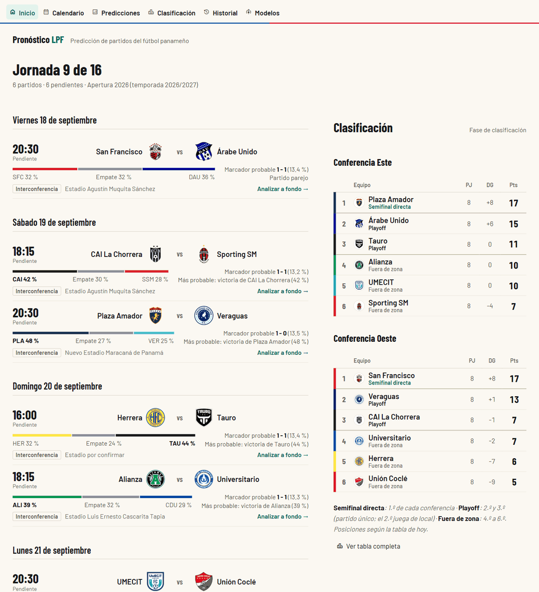
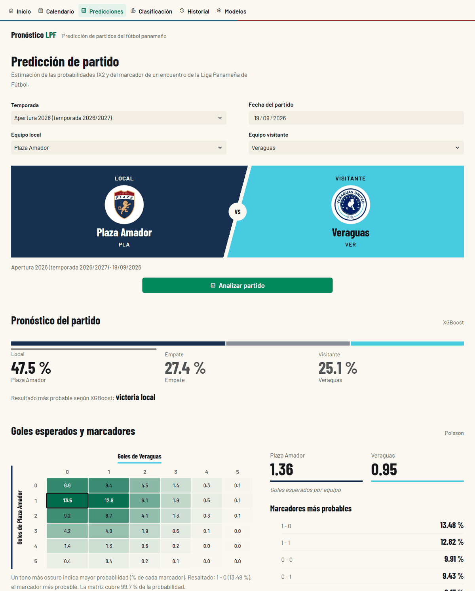
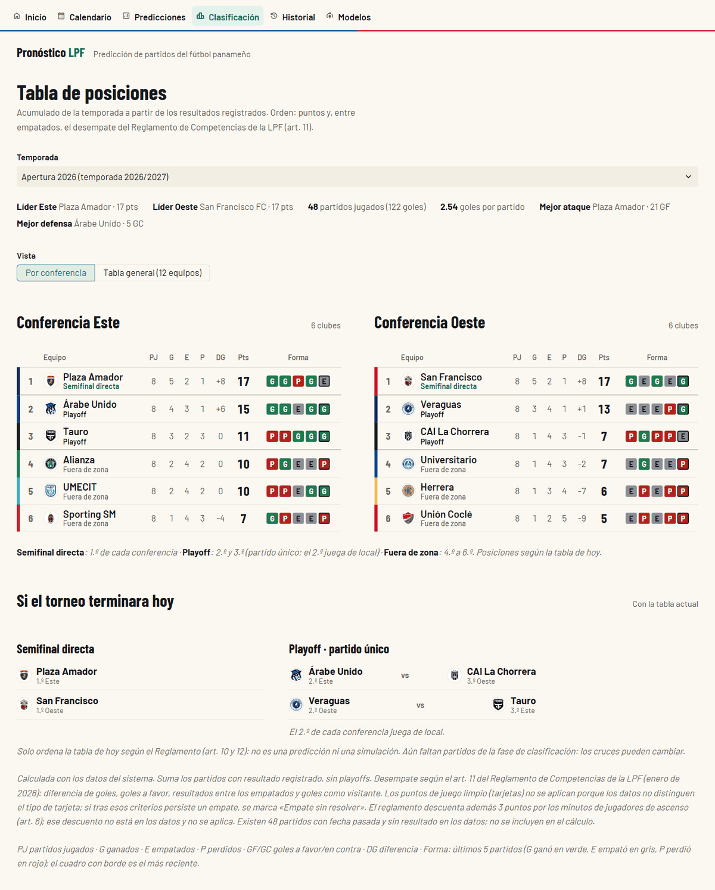
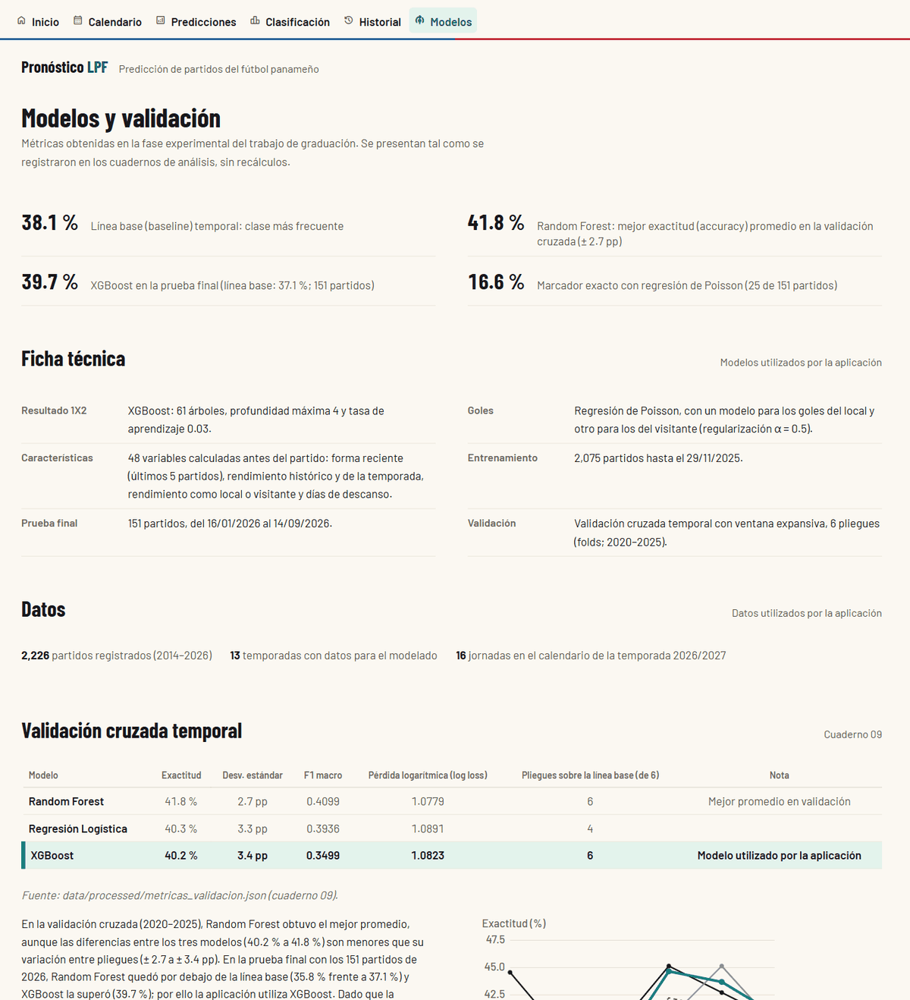
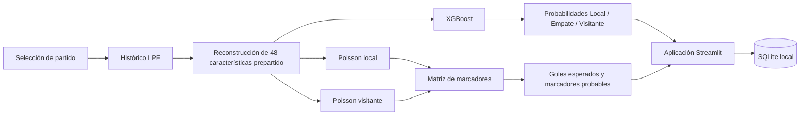

# Desarrollo de un Sistema Predictivo para la Liga Panameña de Fútbol mediante Machine Learning y Análisis Estadístico de Datos Deportivos

**Trabajo de graduación — Universidad Tecnológica de Panamá (UTP)**  
**Facultad de Ingeniería de Sistemas Computacionales (FISC)**  
**Autor:** Richard Smith  
**Área:** Ciencia de datos, aprendizaje automático y analítica deportiva

> Proyecto académico. **No está afiliado a la Liga Panameña de Fútbol (LPF).**

---

## Resumen

Este repositorio contiene el desarrollo experimental y la implementación del sistema predictivo construido para analizar partidos de la **Liga Panameña de Fútbol (LPF)** mediante técnicas de *Machine Learning* y modelado estadístico. El proyecto integra la recopilación y depuración de datos históricos, el análisis exploratorio, la ingeniería de características prepartido, el entrenamiento y la validación temporal de modelos, la estimación probabilística de goles y una aplicación interactiva desarrollada en **Streamlit** (*Pronóstico LPF*).

El objetivo general es estimar las probabilidades de **victoria local, empate y victoria visitante**, complementadas con una estimación de **goles esperados y marcadores probables**. Se evaluaron Regresión Logística, Random Forest y XGBoost como clasificadores directos del resultado, además de modelos de regresión de Poisson para la distribución de goles.

La solución final emplea **XGBoost** como clasificador principal y **Poisson** como componente complementario para goles y marcadores. Los resultados deben interpretarse como estimaciones probabilísticas, no como garantías sobre el resultado futuro de un encuentro.

**Palabras clave:** Liga Panameña de Fútbol, Machine Learning, XGBoost, Random Forest, Regresión Logística, distribución de Poisson, predicción deportiva, análisis de datos.

---

## Vista de la aplicación

| Inicio | Predicciones |
|:---:|:---:|
|  |  |
| **Clasificación** | **Modelos** |
|  |  |

Las capturas corresponden a la temporada 2026/2027 (Apertura 2026) con los datos incluidos en el repositorio. La captura de Predicciones se obtuvo con una base de historial vacía.

---

## Funcionalidades

La aplicación (`app/app.py`) se organiza en seis secciones con navegación superior:

| Sección | Contenido |
|---|---|
| **Inicio** | Jornada en curso con la predicción de cada partido y la clasificación de ambas conferencias. |
| **Calendario** | Partidos por jornada (hora de Panamá), filtro por equipo y predicción de cada encuentro. |
| **Predicciones** | Análisis de un partido: probabilidades 1X2 (XGBoost), goles esperados, cinco marcadores más probables y matriz de marcadores de Poisson (0 a 5 goles). |
| **Clasificación** | Tabla por temporada. En las temporadas 2026 y 2026/2027: tablas Este y Oeste, tabla general, zonas de clasificación y cruces «si el torneo terminara hoy». |
| **Historial** | Análisis ejecutados, almacenados en una base SQLite local. |
| **Modelos** | Métricas, ficha técnica, validación cruzada temporal y figuras de los cuadernos de análisis. |

### Análisis de un partido

La sección Predicciones permite:

1. seleccionar la temporada;
2. definir la fecha del encuentro;
3. seleccionar el equipo local y el visitante;
4. ejecutar el análisis;
5. visualizar las probabilidades de resultado;
6. consultar los goles esperados;
7. visualizar el marcador modal;
8. consultar los cinco marcadores de mayor probabilidad;
9. revisar el historial local de análisis realizados.

La aplicación utiliza únicamente los **12 clubes activos configurados para la interfaz**, sin eliminar del histórico los clubes que participaron en temporadas anteriores.

### Conferencias y clasificación

Para las temporadas **2026** (Clausura 2026) y **2026/2027** (Apertura 2026) la clasificación sigue el Anexo II del *Reglamento de Competencias* de la LPF (enero de 2026): dos conferencias de seis clubes, 16 partidos por equipo, pase directo a semifinales del primero de cada conferencia y partido único de playoff entre el segundo y el tercero de conferencias opuestas.

- La asignación de clubes a conferencias está en `app/config/conferencias.json` y se aplica únicamente a esas dos temporadas; las anteriores conservan la tabla general.
- El desempate sigue el artículo 11: diferencia de goles, goles a favor, marcadores directos entre los empatados y goles como visitante. Si el empate persiste se indica «Empate sin resolver».
- El bloque «Si el torneo terminara hoy» ordena la tabla vigente; no simula partidos ni predice resultados.
- La correspondencia entre la temporada 2026/2027 y el nombre «Apertura 2026» se tomó de la información de la autora; no figura en los datos fuente. El calendario confirma que la jornada 1 se jugó entre el 24 y el 27 de julio de 2026.

### Colores de los clubes

Cada club aporta dos colores, extraídos de su escudo y revisados manualmente (`app/ui/team_colors.py`). Se usan en la barra de probabilidades 1X2, en la cabecera de la sección Predicciones y en las franjas de las tablas. Para evitar confusiones:

- la diferencia entre colores se mide con **CIEDE2000**; si los dos clubes de un partido tienen colores parecidos, el visitante usa su color secundario, o un patrón rayado si tampoco es distinguible;
- el segmento de un club cuyo color se parece al gris del empate se muestra rayado;
- el texto sobre el color de un club cumple el contraste AA (4.5:1); de lo contrario se coloca fuera del color.

### Matriz de Poisson

La sección Predicciones muestra la matriz de probabilidad de cada marcador (0 a 5 goles por equipo), calculada con los goles esperados de los modelos de Poisson del local y del visitante. La celda resaltada coincide con el marcador más probable que informa la aplicación.

---

## Objetivo general

Implementar un sistema inteligente para la predicción de resultados de la Liga Panameña de Fútbol, utilizando técnicas de *Machine Learning* juntamente con análisis y recopilación de datos históricos, evaluando la capacidad predictiva mediante la comparación de distintos modelos estadísticos y de aprendizaje automático.

### Objetivos específicos

1. Recopilar, depurar y estructurar datos históricos de la LPF para conformar un conjunto de datos apto para modelado.
2. Desarrollar modelos supervisados para clasificar el resultado del partido en victoria local, empate o victoria visitante.
3. Implementar un modelo basado en distribución de Poisson para estimar goles y marcadores probables.
4. Desarrollar una interfaz que permita consultar y visualizar las predicciones generadas.
5. Documentar el proceso de desarrollo, entrenamiento, validación, evaluación e implementación del sistema.

---

## Alcance del estudio

El sistema realiza **predicciones prepartido**. Las variables predictoras corresponden únicamente a información disponible antes de cada encuentro. No se emplean como predictores variables generadas durante o después del partido, tales como los goles finales del mismo encuentro, la posesión, los tiros, las tarjetas, los córners u otras estadísticas que no estarían disponibles al momento de emitir una predicción real.

El alcance actual comprende:

- partidos históricos de la LPF entre **2014 y 2026**;
- conservación de las identidades históricas de los clubes;
- **20 clubes** en el histórico integrado y **12 clubes activos** en la interfaz;
- clasificación probabilística del resultado;
- estimación de goles esperados y distribución de marcadores;
- almacenamiento local del historial de consultas en SQLite.

---

## Datos utilizados

La base histórica se integró principalmente a partir de registros de **FootyStats**, complementados con información de **Soccerway** para la temporada 2017/18. Los archivos originales se conservan en `data/raw/` y los conjuntos derivados en `data/processed/`.

| Elemento | Valor |
|---|---:|
| Registros históricos integrados | 2,227 |
| Partidos elegibles para modelado | 2,226 |
| Variables predictoras | 48 |
| Clubes históricos | 20 |
| Inicio del histórico | 18/07/2014 |
| Último partido observado | 14/09/2026 |
| Clases objetivo | Local / Empate / Visitante |

La distribución del objetivo en el conjunto completo de modelado fue aproximadamente: victoria local, 38.68 %; empate, 31.40 %; victoria visitante, 29.92 %.

La temporada 2026/2027 está representada únicamente por los partidos observados hasta la fecha de cierre del conjunto de datos.

> **Fuentes de terceros.** Este repositorio no concede derechos adicionales sobre los datos procedentes de FootyStats, Soccerway u otros proveedores. Cualquier redistribución externa debe respetar las condiciones de las fuentes originales.

---

## Metodología

### Ingeniería de características

Se construyeron **48 características prepartido** que representan el contexto competitivo de ambos equipos antes de cada encuentro: partidos previos, días de descanso, puntos por partido en los últimos encuentros, promedios de goles a favor y en contra, diferencia de goles reciente, rendimiento histórico acumulado, rendimiento dentro de la temporada, rendimiento como local o visitante, diferencias directas entre los indicadores de ambos equipos, variables de calendario y la identidad de los equipos. Para las variables móviles se aplicó un desplazamiento temporal antes de calcular las ventanas, de modo que cada fila utiliza solo partidos anteriores.

### Control de fuga de información

La prevención de fuga de información (*data leakage*) fue un criterio metodológico central:

- los goles finales del mismo partido se utilizaron únicamente como variable objetivo;
- las estadísticas generadas durante el encuentro no se incorporaron como predictores;
- los agregados móviles se calcularon exclusivamente con partidos previos;
- no se retropropagaron estadísticas de temporada completa hacia partidos anteriores;
- las transformaciones de preprocesamiento se ajustaron solo con los datos de entrenamiento;
- la separación de los datos es cronológica;
- el conjunto de prueba final no se utilizó para entrenar los modelos ni para seleccionar sus hiperparámetros (la elección entre modelos se trata en «Justificación de la elección de XGBoost»).

### División temporal

No se utilizó una partición aleatoria, pues podría mezclar información futura con observaciones anteriores.

La división principal fue:

| Conjunto | Periodo | Partidos | Proporción |
|---|---|---:|---:|
| Entrenamiento | 2014/15–2024 | 1,869 | 83.96 % |
| Validación | 2025 | 206 | 9.25 % |
| Prueba final | 2026 y 2026/27 observado | 151 | 6.78 % |

La prueba final comprende los encuentros del 16/01/2026 al 14/09/2026 y se mantuvo reservada mientras se ajustaba cada modelo: no intervino en el entrenamiento, en el preprocesamiento ni en la selección de hiperparámetros, y cada modelo se evaluó sobre ella únicamente después de fijar su configuración. Además, se aplicó una **validación cruzada temporal con ventana expansiva** sobre los años 2020–2025, con seis pliegues (*folds*), para evaluar la estabilidad histórica sin usar los partidos reservados para la prueba final.

### Modelos evaluados

1. **Regresión Logística.** Modelo lineal multiclase de referencia interpretable. El preprocesamiento incluyó imputación, escalado de variables numéricas y codificación *One-Hot* de variables categóricas.
2. **Random Forest.** Ensamble de árboles de decisión, utilizado para capturar relaciones no lineales e interacciones entre variables. Su desempeño temporal mostró una estabilidad destacada durante la validación cruzada.
3. **XGBoost.** Modelo de *gradient boosting* regularizado, utilizado como clasificador principal del resultado. La configuración final se seleccionó antes de consultar la prueba final.
4. **Regresión de Poisson.** Dos modelos independientes, uno para los goles del local y otro para los del visitante. A partir de sus goles esperados (λ local y λ visitante) se construye la matriz de probabilidades de marcador. Poisson no sustituye al clasificador principal: complementa el análisis con escenarios de goles y marcadores.

---

## Resultados

### Prueba final (151 partidos)

El conjunto final de prueba contiene **151 partidos no utilizados para el ajuste de los modelos**.

| Modelo | Exactitud (*accuracy*) | Precisión macro | Exhaustividad macro | F1 macro | Pérdida logarítmica (*log loss*) |
|---|---:|---:|---:|---:|---:|
| Regresión Logística | 36.42 % | 38.76 % | 38.24 % | **36.73 %** | 1.0910 |
| Random Forest | 35.76 % | 35.93 % | 38.42 % | 35.39 % | 1.0862 |
| **XGBoost** | **39.74 %** | **40.28 %** | **39.41 %** | 35.87 % | **1.0836** |
| Línea base (*baseline*) mayoritaria | 37.09 % | — | — | — | — |

### Validación cruzada temporal (2020–2025, seis pliegues)

Estabilidad temporal sobre los seis pliegues (*folds*) de validación temporal 2020–2025:

| Modelo | Exactitud media | Desv. estándar | F1 macro medio | Desv. estándar F1 |
|---|---:|---:|---:|---:|
| **Random Forest** | **41.81 %** | **2.72 %** | **40.99 %** | **2.66 %** |
| Regresión Logística | 40.28 % | 3.26 % | 39.36 % | 3.23 % |
| XGBoost | 40.16 % | 3.45 % | 34.99 % | 3.13 % |

La línea base temporal de la validación cruzada (clase más frecuente) es de 38.1 %.

Estos resultados muestran que la selección del modelo final requiere distinguir entre **estabilidad histórica** y **desempeño sobre el periodo futuro más reciente**.

### Justificación de la elección de XGBoost

Los hiperparámetros de cada modelo se fijaron con la validación (2025), antes de consultar la prueba final. La elección del clasificador principal, en cambio, sí consideró los resultados de la prueba: XGBoost fue seleccionado como **clasificador principal** porque fue el único de los tres clasificadores que superó la línea base en exactitud en la prueba final (+2.65 puntos porcentuales) y obtuvo la mejor exactitud, precisión macro, exhaustividad macro y pérdida logarítmica entre ellos.

En la validación cruzada (2020–2025), Random Forest obtuvo el mejor promedio, aunque las diferencias entre los tres modelos (40.2 % a 41.8 %) son menores que su variación entre pliegues (± 2.7 a ± 3.4 pp). En la prueba final con los 151 partidos de 2026, Random Forest quedó por debajo de la línea base (35.8 % frente a 37.1 %) y XGBoost la superó (39.7 %); por ello la aplicación utiliza XGBoost. Dado que la prueba final también influyó en esta elección, el 39.7 % debe interpretarse como una estimación optimista.

La selección no implica que XGBoost sea superior bajo todos los criterios: la Regresión Logística obtuvo el mayor F1 macro final y Random Forest, el mejor comportamiento promedio en la validación cruzada.

### Modelo de Poisson

La configuración final utiliza regularización α = 0.5, seleccionada mediante validación con la devianza de Poisson.

| Objetivo | MAE | RMSE | Devianza de Poisson |
|---|---:|---:|---:|
| Goles del local | 0.9557 | 1.2944 | 1.2547 |
| Goles del visitante | 0.8187 | 1.0757 | 1.1674 |

Los valores medios estimados en el conjunto de prueba fueron aproximadamente λ local = 1.1974 y λ visitante = 1.0285.

Marcador exacto en la prueba final: modelo con características, 25 de 151 partidos (16.56 %); línea base de Poisson constante, 24 de 151 (15.89 %). La mejora es moderada, por lo que el marcador más probable no debe interpretarse como una predicción determinista; el valor principal del componente es producir una distribución completa de escenarios de anotación.

---

## Arquitectura predictiva



La arquitectura mantiene separados los dos objetivos estadísticos:

| Componente | Modelo | Salida |
|---|---|---|
| Resultado del partido | XGBoost | Probabilidades L/E/V |
| Goles y marcador | Poisson | λ, marcador modal y distribución de resultados |

No se aplica una combinación matemática entre ambos modelos; sus salidas son complementarias.

Los modelos de producción se entrenaron con los 2,075 partidos disponibles hasta el 29/11/2025 (entrenamiento y validación). La aplicación muestra el indicador «Acertó / No acertó» solo para partidos posteriores a esa fecha; los anteriores se rotulan «Dentro del período de entrenamiento».

---

## Validación de la implementación

La capa de inferencia reconstruye las mismas 48 características utilizadas durante el entrenamiento a partir del histórico disponible antes de la fecha seleccionada.

La validación realizada sobre un partido histórico comparó las **48 características generadas en producción con las utilizadas durante el modelado**, obteniendo **0 diferencias**.

También se verificaron:

- la carga de los modelos serializados;
- la alineación del orden de las características;
- el funcionamiento de la inferencia de XGBoost;
- la generación de λ y de la matriz de marcadores;
- la restricción de equipo local distinto al visitante;
- la disponibilidad de los 12 clubes activos de la interfaz;
- la persistencia en SQLite únicamente después de una inferencia explícita;
- la prevención de registros duplicados por rerenderizado de Streamlit.

---

## Estructura del repositorio

```text
Sistema-Predictivo-LPF/
├── app/
│   ├── app.py                  # punto de entrada y navegación
│   ├── config/                 # conferencias por temporada (conferencias.json)
│   ├── assets/
│   │   ├── logos/              # escudos de los clubes
│   │   └── styles/             # hoja de estilos adicional
│   ├── static/fonts/           # tipografías locales (Barlow)
│   ├── services/               # lectura de datos, características, modelos y predicción
│   ├── ui/                     # estilos, componentes y colores de los clubes
│   ├── views/                  # las seis secciones de la aplicación
│   ├── test_features.py        # pruebas de la capa de características
│   ├── test_inference.py       # prueba de inferencia
│   ├── test_desempate.py       # pruebas del desempate de la clasificación
│   ├── test_colores.py         # pruebas de los colores y de la redacción del pronóstico
│   └── test_paginas.py         # prueba de humo de las seis páginas
├── data/
│   ├── raw/                    # datos originales (FootyStats, Soccerway)
│   └── processed/              # conjuntos derivados y metricas_validacion.json
├── docs/
│   ├── img/                    # capturas de este README
│   └── hashes_sha256.json      # sumas SHA-256 de modelos y datos
├── figures/                    # figuras generadas por los cuadernos
├── models/                     # modelos serializados (.joblib)
├── notebooks/                  # cuadernos 01 a 09
├── scripts/verificar_hashes.py # verificación de integridad
├── .streamlit/config.toml      # tema y fuentes de la aplicación
├── .gitignore
├── requirements.txt
└── README.md
```

La base SQLite (`database/`) se genera localmente durante la ejecución y se excluye del control de versiones.

### Modelos serializados

`models/xgboost_lpf.joblib`, `models/xgboost_label_encoder.joblib`, `models/poisson_local_lpf.joblib`, `models/poisson_visitante_lpf.joblib`, `models/random_forest_lpf.joblib` y `models/regresion_logistica_lpf.joblib`.

---

## Instalación y ejecución

### Entorno de ejecución

El proyecto se validó con **Python 3.12**. Las dependencias están fijadas en `requirements.txt`. Entre las principales: pandas, NumPy, scikit-learn, XGBoost, SciPy, Matplotlib, Seaborn, Streamlit, Joblib y Pillow. Los modelos serializados se validaron con **scikit-learn 1.9.0**.

### Windows (PowerShell)

```powershell
git clone https://github.com/charrixxz23/Sistema-Predictivo-LPF.git
Set-Location Sistema-Predictivo-LPF

py -3.12 -m venv .venv
.\.venv\Scripts\Activate.ps1

python -m pip install --upgrade pip
pip install -r requirements.txt
pip check

streamlit run app/app.py
```

Si PowerShell bloquea la activación del entorno, ejecutar antes `Set-ExecutionPolicy -Scope Process -ExecutionPolicy Bypass`.

### Linux / macOS

```bash
git clone https://github.com/charrixxz23/Sistema-Predictivo-LPF.git
cd Sistema-Predictivo-LPF
python3.12 -m venv .venv
source .venv/bin/activate
pip install -r requirements.txt
streamlit run app/app.py
```

La aplicación queda disponible en `http://localhost:8501`. Carga los datos procesados de `data/processed/`, los modelos de `models/`, los recursos visuales de `app/assets/` y crea la base SQLite local en `database/` si no existe.

---

## Reproducibilidad

- **Cuadernos.** Los cuadernos de `notebooks/` documentan el flujo completo: (1) preparación de datos, (2) análisis exploratorio, (3) ingeniería de características, (4) conjuntos de entrenamiento, validación y prueba, (5) Regresión Logística, (6) Random Forest, (7) XGBoost, (8) Poisson y (9) validación cruzada temporal. La numeración y organización responden al flujo experimental utilizado durante el trabajo de graduación. Para reejecutarlos se requiere Jupyter, que no forma parte de `requirements.txt`.
- **Semillas.** Los cuadernos 05, 06, 07 y 09 fijan `random_state = 42`. La regresión de Poisson (cuaderno 08) es determinista y no usa semilla.
- **Métricas.** Las celdas finales de los cuadernos 05 a 09 («Exportación de métricas») escriben `data/processed/metricas_validacion.json`. La sección Modelos de la aplicación lee ese archivo y no recalcula nada. El archivo incluye la fecha de corte del entrenamiento, el rango de la prueba final y los valores por pliegue.
- **Integridad de modelos y datos.** `docs/hashes_sha256.json` guarda la suma SHA-256 de los seis modelos y de los 30 CSV. Para verificarla:

  ```powershell
  python scripts/verificar_hashes.py
  ```

  En los CSV se normalizan los finales de línea antes de calcular la suma, de modo que el resultado no depende de la configuración de Git en cada equipo.
- **Equivalencia de la inferencia.** `app/test_features.py` compara las 48 características que reconstruye la aplicación con las del modelado (0 diferencias).

---

## Pruebas

Desde la raíz del proyecto, con el entorno virtual activo:

```powershell
python app/test_features.py     # características de inferencia frente a las del modelado
python app/test_inference.py    # inferencia XGBoost y Poisson de extremo a extremo
python app/test_desempate.py    # desempate de la clasificación (art. 11), un caso por criterio
python app/test_colores.py      # CIEDE2000, colores de los clubes y redacción del pronóstico
python app/test_paginas.py      # las seis páginas se dibujan sin excepciones
python scripts/verificar_hashes.py
```

`test_features.py` y `test_inference.py` se ejecutaron satisfactoriamente antes de la publicación inicial del repositorio. Las pruebas informan su resultado en la consola; `test_desempate.py`, `test_colores.py`, `test_paginas.py` y `verificar_hashes.py` terminan con `RESULTADO: OK` y código de salida 0 cuando todo coincide.

---

## Limitaciones

Los resultados deben interpretarse considerando las siguientes limitaciones:

- **Muestra de prueba reducida.** La prueba final tiene 151 partidos; con ese tamaño, el error estándar de una exactitud cercana a 40 % es de unos 4 puntos porcentuales. Las diferencias entre modelos son menores que esa incertidumbre.
- **Elección entre modelos influida por la prueba final.** Los hiperparámetros se fijaron con datos de validación, antes de evaluar la prueba; la elección de XGBoost como clasificador principal, en cambio, sí consideró su desempeño en ella, por lo que su 39.7 % es una estimación optimista. Además, el criterio de elección entre modelos no se definió antes de evaluar la prueba.
- **Resultados pendientes.** El calendario de la temporada 2026/2027 contiene 48 partidos con fecha pasada y sin resultado en los datos; no se incluyen en la clasificación ni en las métricas.
- **Criterio de juego limpio no aplicable.** El desempate del artículo 11 del reglamento prevé puntos de juego limpio según el tipo de tarjeta, pero los datos solo registran la cantidad de tarjetas. Los empates que persisten tras los criterios aplicables se marcan como «Empate sin resolver». Tampoco se refleja el descuento de 3 puntos por minutos de jugadores de ascenso (art. 6).
- **Alcance del reglamento.** El Anexo II rige para el Clausura 2026; en temporadas anteriores se usa el mismo orden de desempate solo como referencia.
- **Disponibilidad de datos.** La LPF cuenta con menos datos históricos que las ligas internacionales; la temporada 2017/18 requirió una fuente complementaria, la temporada 2020 presenta condiciones atípicas y 2026/27 es un periodo parcial.
- **Clubes con poca historia** disponen de menos información acumulada.
- **Información prepartido únicamente.** Expulsiones, lesiones de última hora, decisiones arbitrales y eventos fortuitos no pueden anticiparse.
- **Modelo de Poisson.** Supone una simplificación estadística del proceso de anotación.
- **Alcance de la implementación.** Es una aplicación local orientada a la investigación y la demostración, no una infraestructura de producción.
- **Figuras de los cuadernos.** Las imágenes de `figures/` conservan los rótulos originales de los cuadernos, algunos en inglés.

---

## Interpretación responsable

Este proyecto se desarrolló con fines **académicos, investigativos y de analítica deportiva**. Las salidas del sistema son **probabilidades estimadas a partir de patrones históricos**; no constituyen garantías sobre resultados futuros ni certeza estadística. El sistema es una herramienta de apoyo para el análisis previo de encuentros y una demostración de la ciencia de datos aplicada a la Liga Panameña de Fútbol.

---

## Escudos y marcas

Los escudos y las marcas de los clubes pertenecen a sus respectivos clubes y se utilizan en este proyecto únicamente con fines académicos e identificativos.

---

## Seguridad y control de versiones

El repositorio excluye mediante `.gitignore` los entornos virtuales, los archivos `.env`, las claves y credenciales, las cachés de Python, los puntos de control de Jupyter, las bases SQLite locales, los archivos temporales, las configuraciones personales de los editores y las copias de respaldo. Los modelos entrenados y los datos necesarios para la reproducibilidad académica se mantienen versionados cuando corresponde.

---

## Autor

**Richard Smith**  
Licenciatura en Ingeniería en Sistemas y Computación  
Facultad de Ingeniería de Sistemas Computacionales  
Universidad Tecnológica de Panamá  

Este proyecto es de carácter académico y **no está afiliado a la Liga Panameña de Fútbol**.

---

## Estado del proyecto

**Trabajo de graduación — versión académica funcional**

- Preparación de datos: completada
- Ingeniería de características: completada
- Entrenamiento de modelos: completado
- Validación temporal: completada
- Evaluación final: completada
- Aplicación Streamlit: implementada
- Persistencia SQLite: implementada
- Pruebas funcionales: superadas

---

## Licencia y uso académico

Este repositorio corresponde a un trabajo de graduación desarrollado con fines académicos y de investigación. Los componentes de código desarrollados dentro del proyecto pueden estar sujetos a las condiciones que posteriormente se definan para su distribución. Los datos procedentes de fuentes externas conservan las condiciones y derechos de sus respectivos proveedores.
