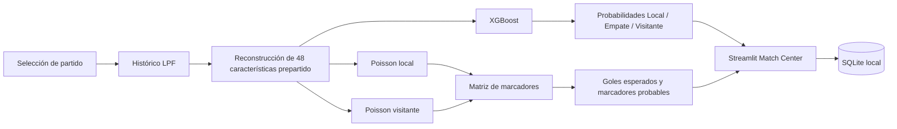

# Desarrollo de un Sistema Predictivo para la Liga Panameña de Fútbol mediante Machine Learning y Análisis Estadístico de Datos Deportivos

**Trabajo de graduación — Universidad Tecnológica de Panamá (UTP)**  
**Facultad de Ingeniería de Sistemas Computacionales (FISC)**  
**Autor:** Richard Smith  
**Área:** Ciencia de datos, aprendizaje automático y analítica deportiva

---

## Resumen

Este repositorio contiene el desarrollo experimental y la implementación del sistema predictivo construido para analizar partidos de la **Liga Panameña de Fútbol (LPF)** mediante técnicas de *Machine Learning* y modelado estadístico. El proyecto integra recopilación y depuración de datos históricos, análisis exploratorio, ingeniería de características prepartido, entrenamiento y validación temporal de modelos, estimación probabilística de goles y una aplicación interactiva desarrollada en **Streamlit**.

El objetivo general es implementar un sistema capaz de estimar las probabilidades de **victoria local, empate y victoria visitante**, complementando esta clasificación con una estimación de **goles esperados y marcadores probables**. Para ello se evaluaron Regresión Logística, Random Forest y XGBoost como clasificadores directos del resultado, además de modelos de regresión de Poisson para la distribución de goles.

La solución final utiliza **XGBoost** como clasificador principal y **Poisson** como componente complementario para goles y marcadores. Los resultados deben interpretarse como estimaciones probabilísticas y no como garantías sobre el resultado futuro de un encuentro.

**Palabras clave:** Liga Panameña de Fútbol, Machine Learning, XGBoost, Random Forest, Regresión Logística, distribución de Poisson, predicción deportiva, análisis de datos.

---

## Objetivo general

Implementar un sistema inteligente para la predicción de resultados de la Liga Panameña de Fútbol, utilizando técnicas de *Machine Learning* juntamente con análisis y recopilación de datos históricos, evaluando la capacidad predictiva mediante la comparación de distintos modelos estadísticos y de aprendizaje automático.

### Objetivos específicos

1. Recopilar, depurar y estructurar datos históricos de la LPF para conformar un conjunto de datos apto para modelado.
2. Desarrollar modelos supervisados para clasificar el resultado del partido en victoria local, empate o victoria visitante.
3. Implementar un modelo basado en distribución de Poisson para estimar goles y marcadores probables.
4. Desarrollar una interfaz que permita consultar y visualizar las predicciones generadas.
5. Documentar el proceso de desarrollo, entrenamiento, validación, evaluación e implementación del sistema.

---

## Alcance del estudio

El sistema fue diseñado para realizar **predicciones prepartido**. Por esta razón, las variables utilizadas como predictores corresponden únicamente a información disponible antes de cada encuentro.

No se emplean como predictores variables generadas durante o después del partido, tales como goles finales del mismo encuentro, posesión, tiros, tarjetas, córners u otras estadísticas que no estarían disponibles al momento de emitir una predicción real.

El alcance actual comprende:

- partidos históricos de la LPF entre **2014 y 2026**;
- conservación de identidades históricas de clubes;
- **20 clubes** presentes en el histórico integrado;
- **12 clubes activos** disponibles en la interfaz actual;
- clasificación probabilística del resultado;
- estimación de goles esperados;
- distribución de marcadores;
- almacenamiento local del historial de consultas mediante SQLite.

---

## Datos utilizados

La base histórica se integró principalmente a partir de registros de **FootyStats**, complementados con información de **Soccerway** para cubrir la temporada 2017/18.

### Resumen del conjunto de datos

| Elemento | Valor |
|---|---:|
| Registros históricos integrados | 2,227 |
| Partidos elegibles para modelado | 2,226 |
| Variables predictoras | 48 |
| Clubes históricos | 20 |
| Inicio del histórico | 2014-07-18 |
| Último partido observado | 2026-09-14 |
| Clases objetivo | Local / Empate / Visitante |

La distribución del objetivo en el conjunto completo de modelado fue aproximadamente:

- **Victoria local:** 38.68 %
- **Empate:** 31.40 %
- **Victoria visitante:** 29.92 %

La temporada 2026/27 se encuentra representada únicamente por los partidos efectivamente observados hasta la fecha de cierre del conjunto de datos.

> **Nota sobre fuentes:** este repositorio no concede derechos adicionales sobre datos procedentes de fuentes de terceros. Cualquier redistribución externa debe respetar las condiciones aplicables de las fuentes originales.

---

## Ingeniería de características

Se construyeron **48 características prepartido** destinadas a representar el contexto competitivo de ambos equipos antes de cada encuentro.

Entre los principales grupos de variables se incluyen:

- cantidad de partidos previos;
- días de descanso;
- puntos por partido en los últimos encuentros;
- promedio de goles a favor y en contra;
- diferencia de goles reciente;
- rendimiento histórico acumulado;
- rendimiento dentro de la temporada;
- rendimiento según condición de local o visitante;
- diferencias directas entre los indicadores de ambos equipos;
- variables de calendario;
- identidad del equipo local y visitante.

Para las variables móviles se aplicó desplazamiento temporal antes del cálculo de ventanas, de manera que cada fila utilizara únicamente información de partidos anteriores.

---

## Control de fuga de información

La prevención de *data leakage* fue un criterio metodológico central del proyecto.

Se aplicaron las siguientes restricciones:

- los goles finales del mismo partido se utilizaron únicamente como variable objetivo;
- las estadísticas generadas durante el encuentro no se incorporaron como predictores;
- los agregados móviles se calcularon utilizando exclusivamente partidos previos;
- se evitó retropropagar estadísticas de temporada completa hacia partidos anteriores;
- las transformaciones de preprocesamiento se ajustaron únicamente sobre los datos de entrenamiento;
- la separación de los datos se realizó de forma cronológica;
- el conjunto final de prueba no fue utilizado para seleccionar hiperparámetros.

---

## División temporal

No se utilizó una partición aleatoria, ya que esta podría mezclar información futura con observaciones anteriores.

La división principal fue:

| Conjunto | Periodo | Partidos | Proporción |
|---|---|---:|---:|
| Entrenamiento | 2014/15–2024 | 1,869 | 83.96 % |
| Validación | 2025 | 206 | 9.25 % |
| Prueba final | 2026 y 2026/27 observado | 151 | 6.78 % |

El conjunto de prueba final comprende encuentros entre **2026-01-16 y 2026-09-14** y se mantuvo reservado hasta congelar las configuraciones finales de los modelos.

Adicionalmente, se aplicó una **validación cruzada temporal con ventana expansiva** sobre los años 2020–2025 para evaluar estabilidad histórica sin utilizar los partidos reservados para prueba final.

---

## Modelos evaluados

### 1. Regresión Logística

Modelo lineal multiclase utilizado como referencia supervisada interpretable. El preprocesamiento incluyó imputación, escalado de variables numéricas y codificación *One-Hot* de variables categóricas.

### 2. Random Forest

Modelo de ensamble basado en árboles de decisión utilizado para capturar relaciones no lineales e interacciones entre variables. Su desempeño temporal mostró una estabilidad destacada durante la validación cruzada.

### 3. XGBoost

Modelo de *gradient boosting* regularizado utilizado para la clasificación principal del resultado del encuentro. La configuración final fue seleccionada antes de consultar el conjunto de prueba final.

### 4. Regresión de Poisson

Se entrenaron dos modelos independientes:

- goles del equipo local;
- goles del equipo visitante.

A partir de sus parámetros esperados (lambda_{local}) y (lambda_{visitante}), se construye una matriz de probabilidades de marcador mediante la distribución de Poisson.

Poisson no se utiliza como sustituto directo del clasificador principal, sino como componente complementario para representar escenarios de goles y marcadores.

---

## Resultados de clasificación en prueba final

El conjunto final de prueba contiene **151 partidos no utilizados para el ajuste de los modelos**.

| Modelo | Accuracy | Precision Macro | Recall Macro | F1 Macro | Log Loss |
|---|---:|---:|---:|---:|---:|
| Regresión Logística | 36.42 % | 38.76 % | 38.24 % | **36.73 %** | 1.0910 |
| Random Forest | 35.76 % | 35.93 % | 38.42 % | 35.39 % | 1.0862 |
| **XGBoost** | **39.74 %** | **40.28 %** | **39.41 %** | 35.87 % | **1.0836** |
| Baseline mayoritario | 37.09 % | — | — | — | — |

XGBoost fue seleccionado como **clasificador principal** debido a su comportamiento global sobre el periodo temporal más reciente reservado para prueba.

Esta selección no implica que haya sido superior bajo todos los criterios. La Regresión Logística obtuvo el mayor F1 Macro final, mientras que Random Forest presentó el mejor comportamiento promedio durante la validación cruzada temporal.

### Estabilidad temporal

Sobre los seis pliegues de validación temporal 2020–2025:

| Modelo | Accuracy media | DE Accuracy | F1 Macro medio | DE F1 |
|---|---:|---:|---:|---:|
| **Random Forest** | **41.81 %** | **2.72 %** | **40.99 %** | **2.66 %** |
| Regresión Logística | 40.28 % | 3.26 % | 39.36 % | 3.23 % |
| XGBoost | 40.16 % | 3.45 % | 34.99 % | 3.13 % |

Estos resultados muestran que la selección del modelo final requiere distinguir entre **estabilidad histórica** y **desempeño sobre el periodo futuro más reciente**.

---

## Resultados del modelo de Poisson

La configuración final utiliza regularización (alpha = 0.5), seleccionada mediante validación a partir de la devianza de Poisson.

### Evaluación de goles en prueba

| Objetivo | MAE | RMSE | Devianza de Poisson |
|---|---:|---:|---:|
| Goles local | 0.9557 | 1.2944 | 1.2547 |
| Goles visitante | 0.8187 | 1.0757 | 1.1674 |

Los valores medios estimados en el conjunto de prueba fueron aproximadamente:

- (lambda_{local} = 1.1974)
- (lambda_{visitante} = 1.0285)

### Marcador exacto

- Modelo con características: **25/151 = 16.56 %**
- Baseline Poisson constante: **24/151 = 15.89 %**

La mejora es moderada, por lo que el marcador modal no debe interpretarse como una predicción determinista. El valor principal del componente Poisson reside en producir una **distribución completa de escenarios de anotación**.

---

## Arquitectura predictiva final



La arquitectura mantiene separados los dos objetivos estadísticos:

| Componente | Modelo | Salida |
|---|---|---|
| Resultado del partido | XGBoost | Probabilidades L/E/V |
| Goles y marcador | Poisson | (lambda), marcador modal y distribución de resultados |

No se aplica una combinación matemática entre ambos modelos; sus salidas son complementarias.

---

## Validación de la implementación

La capa de inferencia reconstruye las mismas 48 características utilizadas durante el entrenamiento a partir del histórico disponible antes de la fecha seleccionada.

La validación realizada sobre un partido histórico comparó las **48 características generadas en producción con las utilizadas durante el modelado**, obteniendo **0 diferencias**.

También se verificaron:

- carga de modelos serializados;
- alineación del orden de características;
- funcionamiento de la inferencia XGBoost;
- generación de (lambda) y matriz de marcadores;
- restricción de equipo local distinto al visitante;
- disponibilidad de los 12 clubes activos de la interfaz;
- persistencia SQLite únicamente después de una inferencia explícita;
- prevención de registros duplicados por rerenderizado de Streamlit.

---

## Aplicación

La interfaz fue desarrollada en **Streamlit** con un diseño tipo *Match Center*.

Permite:

1. seleccionar temporada;
2. definir fecha del encuentro;
3. seleccionar equipo local y visitante;
4. ejecutar el análisis;
5. visualizar probabilidades de resultado;
6. consultar goles esperados;
7. visualizar el marcador modal;
8. consultar los cinco marcadores de mayor probabilidad;
9. revisar el historial local de análisis realizados.

La aplicación utiliza únicamente los **12 clubes activos configurados para la interfaz**, sin eliminar del histórico los clubes que participaron en temporadas anteriores.

---

## Estructura del repositorio

```text
Sistema-Predictivo-LPF/
├── app/
│   ├── app.py
│   ├── assets/
│   │   ├── logos/
│   │   └── styles/
│   ├── services/
│   │   ├── database_service.py
│   │   ├── feature_service.py
│   │   ├── model_service.py
│   │   ├── poisson_service.py
│   │   ├── prediction_service.py
│   │   └── team_assets.py
│   ├── test_features.py
│   └── test_inference.py
├── data/
│   ├── raw/
│   └── processed/
├── figures/
├── models/
├── notebooks/
├── .gitignore
├── README.md
└── requirements.txt
```

La base SQLite se genera localmente durante la ejecución y se excluye del control de versiones.

---

## Modelos serializados incluidos

- `models/xgboost_lpf.joblib`
- `models/xgboost_label_encoder.joblib`
- `models/poisson_local_lpf.joblib`
- `models/poisson_visitante_lpf.joblib`
- `models/random_forest_lpf.joblib`
- `models/regresion_logistica_lpf.joblib`

---

## Entorno de ejecución

El proyecto fue validado en **Python 3.12**.

Las dependencias se encuentran fijadas en `requirements.txt`. Entre las principales:

- pandas
- NumPy
- scikit-learn
- XGBoost
- SciPy
- Matplotlib
- Seaborn
- Streamlit
- Joblib

Los modelos serializados fueron validados con **scikit-learn 1.9.0**.

---

## Instalación

### 1. Clonar el repositorio

```bash
git clone https://github.com/charrixxz23/Sistema-Predictivo-LPF.git
cd Sistema-Predictivo-LPF
```

> El repositorio es actualmente privado, por lo que la clonación requiere una cuenta autorizada.

### 2. Crear entorno virtual

#### Windows PowerShell

```powershell
py -3.12 -m venv .venv
.\.venv\Scripts\Activate.ps1
```

#### Linux / macOS

```bash
python3.12 -m venv .venv
source .venv/bin/activate
```

### 3. Instalar dependencias

```bash
python -m pip install --upgrade pip
pip install -r requirements.txt
```

### 4. Verificar dependencias

```bash
pip check
```

---

## Ejecución de la aplicación

Desde la raíz del proyecto:

```bash
streamlit run app/app.py
```

Streamlit iniciará el servidor local y cargará:

- datos procesados desde `data/processed/`;
- modelos desde `models/`;
- recursos visuales desde `app/assets/`;
- base SQLite local en `database/`.

---

## Pruebas funcionales

Se incluyen pruebas específicas para verificar la capa de características y la inferencia:

```bash
python app/test_features.py
python app/test_inference.py
```

Ambas pruebas fueron ejecutadas satisfactoriamente antes de la publicación inicial del repositorio.

---

## Flujo de investigación reproducible

Los notebooks documentan las principales etapas metodológicas:

1. obtención e integración de datos;
2. análisis exploratorio;
3. ingeniería de características;
4. construcción del conjunto de entrenamiento, validación y prueba;
5. Regresión Logística;
6. Random Forest;
7. XGBoost;
8. Poisson;
9. validación cruzada temporal.

La numeración y organización responden al flujo experimental utilizado durante el trabajo de graduación.

---

## Limitaciones

Los resultados deben interpretarse considerando las siguientes limitaciones:

- la disponibilidad de datos históricos de la LPF es menor que la existente en ligas internacionales;
- la temporada 2017/18 requirió una fuente complementaria;
- la temporada 2020 presenta condiciones competitivas atípicas;
- 2026/27 es un periodo parcial;
- clubes nuevos o con poca historia disponen de menos información acumulada;
- el sistema utiliza únicamente información prepartido estructurada disponible en el conjunto de datos;
- factores como expulsiones, lesiones de última hora, decisiones arbitrales y eventos fortuitos no pueden anticiparse completamente;
- el modelo de Poisson supone una simplificación estadística del proceso de anotación;
- la implementación actual es una aplicación local orientada a investigación y demostración, no una infraestructura productiva de alta disponibilidad.

---

## Interpretación responsable

Este proyecto fue desarrollado con fines **académicos, investigativos y de analítica deportiva**.

Las salidas del sistema representan **probabilidades estimadas a partir de patrones históricos**. No constituyen garantías sobre resultados futuros ni deben interpretarse como certeza estadística.

El sistema debe entenderse como una herramienta de apoyo para el análisis previo de encuentros y como una demostración de la aplicación de ciencia de datos al contexto de la Liga Panameña de Fútbol.

---

## Seguridad y control de versiones

El repositorio excluye mediante `.gitignore`:

- entornos virtuales;
- archivos `.env`;
- claves y credenciales;
- cachés de Python;
- checkpoints de Jupyter;
- bases SQLite locales;
- archivos temporales;
- configuraciones personales de editores;
- copias de respaldo.

Los modelos entrenados y los datos necesarios para la reproducibilidad académica se mantienen versionados cuando corresponde.

---

## Autor

**Richard Smith**  
Licenciatura en Ingeniería en Sistemas y Computación  
Facultad de Ingeniería de Sistemas Computacionales  
Universidad Tecnológica de Panamá

---

## Estado del proyecto

**Trabajo de graduación — versión académica funcional**

- Preparación de datos: completada
- Ingeniería de características: completada
- Entrenamiento de modelos: completado
- Validación temporal: completada
- Evaluación final: completada
- Aplicación Streamlit: implementada
- Persistencia SQLite: implementada
- Pruebas funcionales: superadas

---

## Licencia y uso académico

Este repositorio corresponde a un trabajo de graduación desarrollado con fines académicos y de investigación.

Los componentes de código desarrollados dentro del proyecto pueden estar sujetos a las condiciones que posteriormente se definan para su distribución. Los datos procedentes de fuentes externas conservan las condiciones y derechos correspondientes a sus respectivos proveedores.
